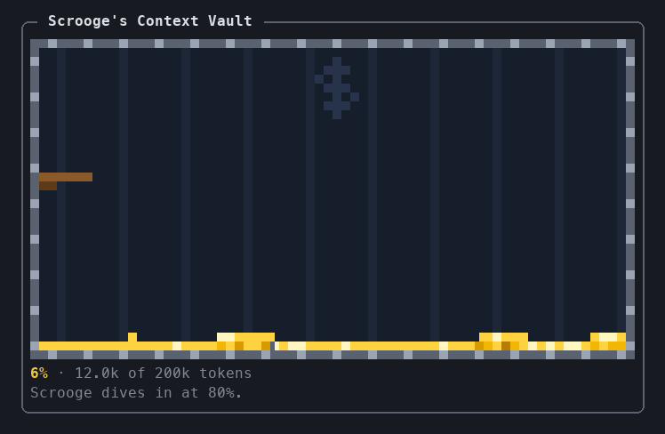

# Scrooge's Context Vault

A Claude Code mod that shows your context window as Scrooge McDuck's Money Bin. Coins fill the bin as the context fills. At 80% (or the percentage you set), Scrooge steps onto his diving board, dives in head first and swims through the coins until you `/compact` or `/clear`.



- **Terminal:** a pixel-art pane drawn in quadrant block characters.
- **Desktop app, VS Code and mobile:** the same scene as an animated SVG.

## Install

```
/plugin install scrooge-context-vault --marketplace twentynineteen/scrooge-context-vault
```

Answer `y` to add the marketplace, then pick the user scope.

## Use

| Command | What it does |
| --- | --- |
| `/scrooge-context-vault` | Opens the vault pane |
| `/scrooge-context-vault demo [percent]` | Fills the bin to a pretend level (85% by default) so you can watch Scrooge dive |
| `/scrooge-context-vault demo off` | Goes back to the real context window |
| `/scrooge-context-vault pixels small` | Fine quadrant-block pixels (the default) |
| `/scrooge-context-vault pixels big` | Chunky half-block pixels |

The pane opens by itself in a terminal at least 144 columns wide.

### Settings

| Setting | Default | What it does |
| --- | --- | --- |
| Dive at (%) | 80 | The context window percentage at which Scrooge dives in (1 to 100) |

Change it in `/config`, or in `~/.claude/settings.json` under `pluginConfigs`.

## Develop

From this folder:

```
claude plugin validate .
claude plugin test .
```

Installed from a local folder, sessions read the mod straight from it, so `/reload-plugins` picks up edits.
